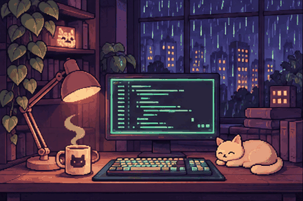

<a href="https://git.io/typing-svg">
  <picture>
    <source media="(prefers-color-scheme: dark)" srcset="https://readme-typing-svg.demolab.com?font=Monaspace+krypton&amp;pause=1000&amp;color=B9A5D6&amp;random=true&amp;center=true&amp;width=435&amp;lines=hey%2C+it's+Anas!;Hex+dancing+in+dark+corners;Surfing+the+forbidden+waves;Weaving+nightmares+in+assembly;Summoning+shells+from+the+ether;Glib+jocks+quiz+nymph+to+vex+dwarf;Testing+doors+with+crafted+whispers">
    
  </picture>
</a>

<picture>
  <source media="(prefers-reduced-motion: reduce)" srcset="assets/desk-still.png">
  
</picture>

  
  &nbsp;
  

  <b>Anas</b> · penetration testing &amp; security research 
  Rust, Windows internals, and the details beneath the surface.

### projects

**[Aria](https://github.com/0xans/Aria)** &nbsp; RUST · OFFENSIVE DEVELOPMENT  
A modern command-and-control project.

**[SysHaze](https://github.com/0xans/SysHaze)** &nbsp; RUST · WINDOWS INTERNALS  
A `no_std` indirect syscall engine for Windows.

**[Yurei](https://github.com/0xans/Yurei)** &nbsp; RUST · NETWORKING  
A port scanner written in Rust.

**[Mirror Gate](https://github.com/0xans/Mirror-Gate)** &nbsp; RUST · SECURITY RESEARCH  
Process-injection research using the Windows Console API.

### interests

`Web exploitation` &nbsp; `Red teaming` &nbsp; `Malware development` &nbsp; `OS internals`

### certifications

`eCPPT` &nbsp; `C|EH`

### development

